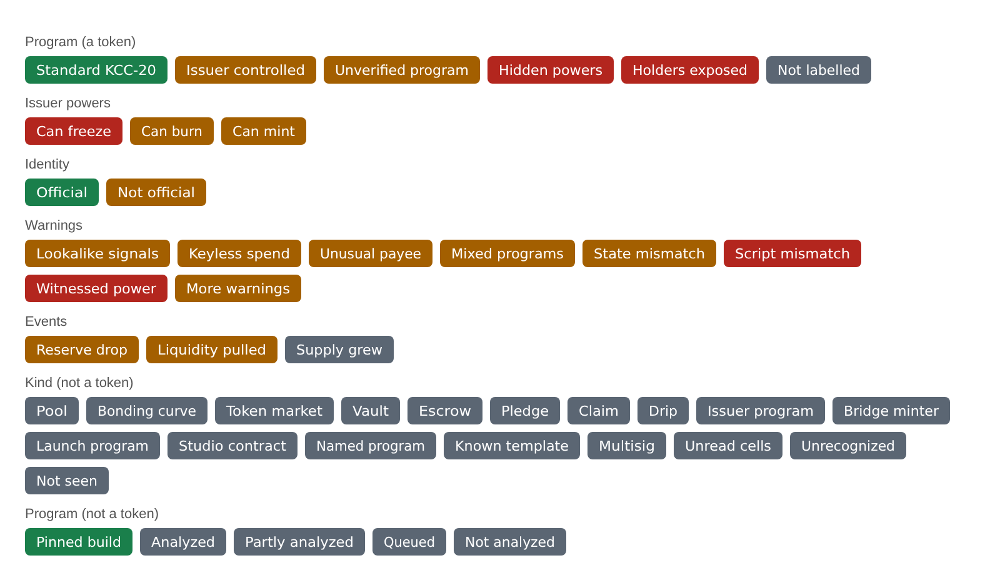
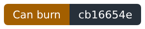
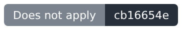
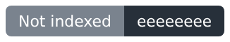

# Kaspero Labs Scan: the badge API

One call per covenant ID. The answer is a short list of badges in plain English, each one or two words, each also
available as a live image. Show the ones you want; link them to the Scan page for the evidence.

Free, no key, no sign-up, open to any origin (CORS `*`). Kept by Kaspero Labs. Full docs:
https://scan.kasperolabs.com/docs

Take all of it, some of it, or none. Every badge is listed below so you can decide which ones fit your site.

## What stands behind a badge

- **Program badges are tested, not only matched.** A program is first compared byte for byte with published builds.
  Anything that matches no published build goes through the Kaspa Red Team analyzer
  (https://github.com/kasperolabs/kaspa-redteam): it rebuilds the program's real spends, replaces the person who made
  them with an outsider, and changes them one thing at a time (recipients, amounts, signatures, entry points) to see
  what the program accepts. "Keyless spend", "Hidden powers" and "Holders exposed" each rest on a transaction the
  engine accepted, kept as evidence.
- **"Official" is entered by hand.** Kaspero Labs adds a covenant ID to the official list only with the project's own
  public announcement on record (the address, and where possible a screenshot and a note). It is a person checking a
  public statement, not code, and the evidence is one call away (`badge.evidence`) so anyone can check the same thing.
- **Nothing here is a guarantee.** The analyzer finding no power is not a proof, and Kaspero Labs does not vouch for
  any token. Every Scan page lists what was not checked.



## The call

```
GET https://scan.kasperolabs.com/api/kcc20/safety/<covenantId>/badge
```

`<covenantId>` is 64 hex characters. It can be a KCC-20 token or any other covenant (a pool, a curve, a vault).

What you need from the answer:

| Field | What it holds |
|---|---|
| `badge.badges` | The list. One row per badge: `{ id, group, text, tone, about, svg }` |
| `badge.image` | All of the covenant's badges as one live SVG image |
| `badge.page` | The Scan page for this covenant, with the evidence behind every badge. Link here. |
| `badge.level`, `badge.headline` | One color (green, amber, red, none) and one plain sentence, if you want a single line |

A row:

| Field | What it holds |
|---|---|
| `id` | The badge's fixed name. Ids are only added, never renamed. |
| `group` | `program`, `power`, `identity`, `warning`, `event`, `kind` or `index` |
| `text` | One or two words. Show it as given. |
| `tone` | `good`, `neutral`, `caution` or `danger`. Pick your color or icon by it. |
| `about` | One sentence for a tooltip |
| `svg` | This badge as a live image |

## Example 1: NACHO

A standard KCC-20 that is also on the official list.


```
curl https://scan.kasperolabs.com/api/kcc20/safety/41d44970ba6307bcec418f677fd253778d0ffa47750d179dff647061aa6c0d40/badge
```

```json
{
  "success": true,
  "schema": "kcc20-safety-badge/1",
  "attribution": "Kaspero Labs token safety (facts with evidence, not verdicts)",
  "docs": "https://scan.kasperolabs.com/docs",
  "appeal": "Kaspero Labs: open an issue at https://github.com/kasperolabs/kaspa-redteam/issues with the covenant ID; a label shown wrong gets a corpus case and a rerun",
  "badge": {
    "found": true,
    "covenantId": "41d44970ba6307bcec418f677fd253778d0ffa47750d179dff647061aa6c0d40",
    "name": "NACHO",
    "ticker": "NACHO",
    "label": "standard",
    "level": "green",
    "headline": "A plain KCC-20: only your key moves your coins",
    "issuerPowers": [],
    "official": true,
    "officialName": null,
    "officialCovenants": [
      "41d44970ba6307bcec418f677fd253778d0ffa47750d179dff647061aa6c0d40"
    ],
    "officialAnnounced": "https://x.com/NachotheKat/status/2116240787239281081",
    "warnings": [],
    "dangers": [],
    "signals": [
      "UNSOLICITED_SENDS",
      "METADATA_LINKS"
    ],
    "page": "https://scan.kasperolabs.com/?cov=41d44970ba6307bcec418f677fd253778d0ffa47750d179dff647061aa6c0d40",
    "report": "https://scan.kasperolabs.com/api/kcc20/safety/41d44970ba6307bcec418f677fd253778d0ffa47750d179dff647061aa6c0d40",
    "evidence": "https://scan.kasperolabs.com/api/kcc20/official/41d44970ba6307bcec418f677fd253778d0ffa47750d179dff647061aa6c0d40",
    "asOf": "2026-11-09T22:26:21.700Z",
    "changes": [],
    "badges": [
      {
        "id": "standard",
        "group": "program",
        "text": "Standard KCC-20",
        "tone": "good",
        "about": "Every live coin runs a published KCC-20 build: only the holder's key moves a coin.",
        "svg": "https://scan.kasperolabs.com/api/kcc20/safety/41d44970ba6307bcec418f677fd253778d0ffa47750d179dff647061aa6c0d40/badge/standard.svg"
      },
      {
        "id": "official",
        "group": "identity",
        "text": "Official",
        "tone": "good",
        "about": "This covenant ID is on Kaspero Labs' list of official tokens for its name, entered by hand with the project's own public announcement on record. Identity, not value.",
        "svg": "https://scan.kasperolabs.com/api/kcc20/safety/41d44970ba6307bcec418f677fd253778d0ffa47750d179dff647061aa6c0d40/badge/official.svg"
      }
    ],
    "image": "https://scan.kasperolabs.com/api/kcc20/safety/41d44970ba6307bcec418f677fd253778d0ffa47750d179dff647061aa6c0d40/badge.svg"
  }
}
```

Two badges:

| Badge | Image | Why |
|---|---|---|
| Standard KCC-20 |  | Every live coin runs the published KCC-20 build. Only the holder's key moves a coin. |
| Official |  | This covenant ID is on Kaspero Labs' list for the name NACHO, entered by hand. `officialAnnounced` is the project's own post; `badge.evidence` adds a screenshot and a note. |

Note `signals`: NACHO carries `UNSOLICITED_SENDS` and `METADATA_LINKS`. Those are activity codes, and on their own
they are ordinary (wallet transfers, a website in the metadata). **A single activity signal never becomes a badge.**

## Example 2: TreeHouse (TREE)

A token whose issuer has powers over holders' coins.


```
curl https://scan.kasperolabs.com/api/kcc20/safety/cb16654e2603774f19a3fecd62c9175353622da9889b12b5078bcac137b1a2fd/badge
```

```json
{
  "success": true,
  "schema": "kcc20-safety-badge/1",
  "attribution": "Kaspero Labs token safety (facts with evidence, not verdicts)",
  "docs": "https://scan.kasperolabs.com/docs",
  "appeal": "Kaspero Labs: open an issue at https://github.com/kasperolabs/kaspa-redteam/issues with the covenant ID; a label shown wrong gets a corpus case and a rerun",
  "badge": {
    "found": true,
    "covenantId": "cb16654e2603774f19a3fecd62c9175353622da9889b12b5078bcac137b1a2fd",
    "name": "TreeHouse",
    "ticker": "TREE",
    "label": "issuer-controlled",
    "level": "amber",
    "headline": "The issuer can act on holders' coins",
    "issuerPowers": [
      "apply",
      "burn",
      "freeze",
      "mint",
      "propose",
      "release"
    ],
    "official": null,
    "officialName": null,
    "officialCovenants": [],
    "officialAnnounced": null,
    "warnings": [],
    "dangers": [],
    "signals": [],
    "page": "https://scan.kasperolabs.com/?cov=cb16654e2603774f19a3fecd62c9175353622da9889b12b5078bcac137b1a2fd",
    "report": "https://scan.kasperolabs.com/api/kcc20/safety/cb16654e2603774f19a3fecd62c9175353622da9889b12b5078bcac137b1a2fd",
    "evidence": null,
    "asOf": "2026-11-09T22:26:22.192Z",
    "changes": [],
    "badges": [
      {
        "id": "issuer-controlled",
        "group": "program",
        "text": "Issuer controlled",
        "tone": "caution",
        "about": "Coins run a published build in which the issuer can also act on holders' coins (the full report names each power).",
        "svg": "https://scan.kasperolabs.com/api/kcc20/safety/cb16654e2603774f19a3fecd62c9175353622da9889b12b5078bcac137b1a2fd/badge/issuer-controlled.svg"
      },
      {
        "id": "can-freeze",
        "group": "power",
        "text": "Can freeze",
        "tone": "danger",
        "about": "The issuer can freeze a holder's coins without the holder's signature (an entry the published build declares).",
        "svg": "https://scan.kasperolabs.com/api/kcc20/safety/cb16654e2603774f19a3fecd62c9175353622da9889b12b5078bcac137b1a2fd/badge/can-freeze.svg"
      },
      {
        "id": "can-burn",
        "group": "power",
        "text": "Can burn",
        "tone": "caution",
        "about": "The issuer can destroy coins of this token (an entry the published build declares).",
        "svg": "https://scan.kasperolabs.com/api/kcc20/safety/cb16654e2603774f19a3fecd62c9175353622da9889b12b5078bcac137b1a2fd/badge/can-burn.svg"
      },
      {
        "id": "can-mint",
        "group": "power",
        "text": "Can mint",
        "tone": "caution",
        "about": "The issuer can create new coins of this token (an entry the published build declares).",
        "svg": "https://scan.kasperolabs.com/api/kcc20/safety/cb16654e2603774f19a3fecd62c9175353622da9889b12b5078bcac137b1a2fd/badge/can-mint.svg"
      }
    ],
    "image": "https://scan.kasperolabs.com/api/kcc20/safety/cb16654e2603774f19a3fecd62c9175353622da9889b12b5078bcac137b1a2fd/badge.svg"
  }
}
```

Four badges:

| Badge | Image | Why |
|---|---|---|
| Issuer controlled |  | Its coins run a published build in which the issuer can also act on holders' coins. |
| Can freeze |  | The build lets the issuer freeze a holder's coins without the holder's signature. |
| Can burn |  | The build lets the issuer destroy coins. |
| Can mint |  | The build lets the issuer create new coins. |

`issuerPowers` lists every entry the build gives the issuer: mint, burn, freeze, release, propose, apply. Three of
them reach a holder's coins or the supply, and those are badges. Release (unfreeze), propose and apply are the
issuer's own procedure and stay in the list only.

These badges say the powers exist in the program. They say nothing about whether a power has been used or why it is
there; a regulated stablecoin would carry the same ones.

TREE has no "Official" badge because no covenant ID is listed for its name (`official: null`). That is the normal
state for most tokens and is not a warning.

## The images

```
GET https://scan.kasperolabs.com/api/kcc20/safety/<covenantId>/badge.svg          all badges in one image
GET https://scan.kasperolabs.com/api/kcc20/safety/<covenantId>/badge/<id>.svg     one badge
```

Put it on a page:

```html
<a href="https://scan.kasperolabs.com/?cov=COVENANT_ID">
  
</a>
```

- **The image is live.** It is drawn from the covenant's facts at that moment (kept 5 minutes). If the facts change,
  the same address shows a different picture. Nothing to update on your side.
- **An address you embedded never breaks.** A badge that does not apply now answers a grey image:
   A covenant that is not in the index: 
- **Every image carries the covenant's first 8 hex characters.** An "Official" image belongs to one covenant ID.
  With the ID printed on it, it cannot pass for another token's badge.
- **No token name on an image.** Names and tickers are text anyone can write on chain. An image holds only the words
  listed below.

## Every badge

### A token

Always one `program` badge first; for an issuer-controlled token, its `power` badges; then identity if a covenant ID is
listed for its name; then warnings and events.

| id | text | tone | What it means |
|---|---|---|---|
| `standard` | Standard KCC-20 | good | Every live coin runs a published KCC-20 build: only the holder's key moves a coin. |
| `issuer-controlled` | Issuer controlled | caution | Coins run a published build in which the issuer can also act on holders' coins (the full report names each power). |
| `unverified` | Unverified program | caution | Coins run a program no published build matches. The analyzer found no power in what it tried, which is not a proof. |
| `hidden-powers` | Hidden powers | danger | The analyzer has an accepted transaction showing a power the program does not declare. |
| `holders-exposed` | Holders exposed | danger | The analyzer has an accepted transaction in which an outsider moves holders' value. |
| `not-labelled` | Not labelled | neutral | No coin of this token has been checked yet. |

| id | text | tone | What it means |
|---|---|---|---|
| `can-freeze` | Can freeze | danger | The issuer can freeze a holder's coins without the holder's signature (an entry the published build declares). |
| `can-burn` | Can burn | caution | The issuer can destroy coins of this token (an entry the published build declares). |
| `can-mint` | Can mint | caution | The issuer can create new coins of this token (an entry the published build declares). |

| id | text | tone | What it means |
|---|---|---|---|
| `official` | Official | good | This covenant ID is on Kaspero Labs' list of official tokens for its name, entered by hand with the project's own public announcement on record. Identity, not value. |
| `not-official` | Not official | caution | Another covenant ID is on Kaspero Labs' list as the official token for this name. |

| id | text | tone | What it means |
|---|---|---|---|
| `lookalike-signals` | Lookalike signals | caution | A name or icon resemblance together with a program difference or unasked activity. Each alone is common; the full report lists what was combined. |
| `keyless-spend` | Keyless spend | caution | On some paths a coin moved with no signature from its holder: the analyzer replaced the person in real spends with an outsider and the program accepted. |
| `unusual-payee` | Unusual payee | caution | This token's pool or curve pays a different address than every other copy of the same program. |
| `mixed-programs` | Mixed programs | caution | Some coins of this covenant run a different program than its first coin. |
| `state-mismatch` | State mismatch | caution | Some coins have the bytes of a published build but state that names other templates, so they are not that build's cells. |
| `script-mismatch` | Script mismatch | danger | Some coins' scripts do not hash to their own addresses. |
| `witnessed-power` | Witnessed power | danger | The analyzer has an accepted transaction showing a power in a program this token depends on (its pool or curve). |
| `more-warnings` | More warnings | caution | The full report carries warnings this list has no short name for yet. |

| id | text | tone | What it means |
|---|---|---|---|
| `reserve-drop` | Reserve drop | caution | A reserve fell by more than the program's own formula allows for what moved. The full report names the transaction and the amounts. |
| `liquidity-pulled` | Liquidity pulled | caution | A large share of a pool's liquidity was withdrawn. The full report names the transaction and who received it. |
| `supply-grew` | Supply grew | neutral | New units were created. The full report names the transaction and the amounts. |

### A covenant that is not a token

One `kind` badge (what it is), then one `program` badge, then warnings and events. Never a green level: a kind is
not a verdict.

| id | text | tone | What it means |
|---|---|---|---|
| `kind-pool` | Pool | neutral | A pool. |
| `kind-curve` | Bonding curve | neutral | A bonding curve. |
| `kind-companion` | Token market | neutral | A pool or curve: its own state names a token's covenant ID. |
| `kind-vault` | Vault | neutral | A vault. |
| `kind-escrow` | Escrow | neutral | An escrow. |
| `kind-pledge` | Pledge | neutral | A pledge. |
| `kind-claim` | Claim | neutral | A claim. |
| `kind-drip` | Drip | neutral | A drip. |
| `kind-issuer` | Issuer program | neutral | An issuer program. |
| `kind-minter` | Bridge minter | neutral | A bridge minter. |
| `kind-launch` | Launch program | neutral | A KCC-20 launch program. |
| `kind-studio` | Studio contract | neutral | A contract deployed through SilverScript Studio. |
| `kind-named` | Named program | neutral | A program on Kaspero Labs' list of named programs. |
| `kind-template` | Known template | neutral | Its code has the shape of a known template. |
| `kind-multisig` | Multisig | neutral | A standard multisig script. |
| `kind-token-unread` | Unread cells | neutral | Token cells in a layout this index does not read. |
| `kind-unrecognized` | Unrecognized | neutral | A program this index has no name for. |
| `kind-unseen` | Not seen | neutral | Its program has not been revealed on chain yet (no coin of it has been spent). |

| id | text | tone | What it means |
|---|---|---|---|
| `pinned-build` | Pinned build | good | Its code matches a build this index has pinned, byte for byte. |
| `analyzed` | Analyzed | neutral | The analyzer changed its real spends every way it knows and found no power, which is not a proof. |
| `partly-analyzed` | Partly analyzed | neutral | The analyzer found no power in what it could try; some paths were not explored. |
| `queued` | Queued | neutral | Queued for the analyzer. |
| `not-analyzed` | Not analyzed | neutral | Not analyzed yet. |

### Not in the index

| id | text | tone | What it means |
|---|---|---|---|
| `not-indexed` | Not indexed | neutral | This covenant ID is not in the index (it has not been seen moving, or its trace is not finished). |

## Many at once

```
GET  https://scan.kasperolabs.com/api/kcc20/safety/badges?ids=<id>,<id>,...
POST https://scan.kasperolabs.com/api/kcc20/safety/badges   { "covenantIds": ["<id>", "<id>"] }
```

Up to 50 covenant IDs, answered in the order asked: `{ success, schema, badges: [...], limited }`. Each entry of the
outer `badges` is one covenant's badge, with its own `badges` rows inside.

## How to show it

1. Show the words as given, and link them to `badge.page`.
2. Do not turn a badge into a verdict. "Standard KCC-20" is not a guarantee; "Issuer controlled" and "Unverified
   program" say what a program allows, not who someone is. Words like "verified", "trusted" or "fake" would be yours,
   not the API's.
3. Do not hide a token because of a badge. Label it and let the holder decide.
4. "Official" is identity, not value. It means: this covenant ID is the one the project announced.
5. A wallet that asks a holder to sign should read the badge at that moment, not from a day-old copy.

## Limits and versions

- A badge is kept for 5 minutes; answers from that cache are free. Each new computation counts against 120 per
  address per 10 minutes. Past that a single badge answers 429, a batch marks the rest `retry: true`, and an image
  reads "Try again later".
- For higher volume, ask Kaspero Labs for a partner key (sent as `X-Kcc20-Partner-Key`).
- `schema` is `kcc20-safety-badge/1`. Within a schema, fields and badge ids are only added, never removed or
  renamed.

## Something wrong?

Something shown wrong, or your own covenant: open an issue at https://github.com/kasperolabs/kaspa-redteam/issues
with the covenant ID.

Answers in this document are from November 9, 2026.
